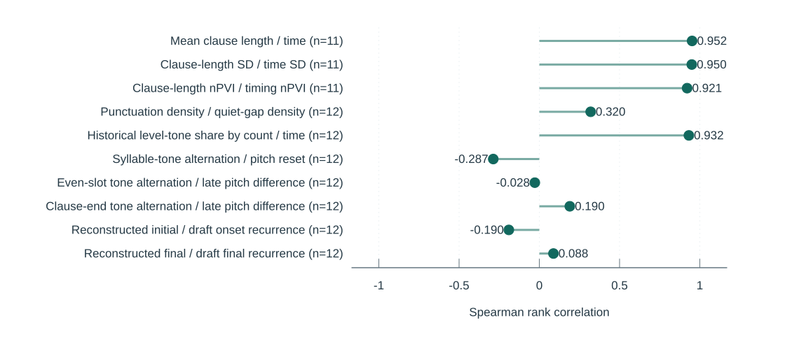

# Reading ease and sound-pattern beauty in Chinese parallel prose

## Question and result

What makes a Chinese passage easy to say on its first reading (顺口), and which properties of its audible pattern make it pleasing to hear (音律美)? This pilot starts with parallel prose (骈文) and period-matched comparison prose (散文). It asks how historical sound patterns, the phrasing of an edition, and the sounds heard in a particular performance relate to the two judgments.

**Pilot result.** Written clause length strongly tracked articulation time in the controlled Mandarin recordings. Historical level–oblique alternation (平仄) showed weak or mixed associations with performed pitch, and every formal comparison with a shuffled control exceeded the 0.05 threshold after correction. In the author follow-up, shorter clauses coincided with easier first reads across four passages and with higher overall ratings across four listening pairs. The listening pairs used several comparison designs. Independent readers and listeners are needed to test the associations. [Formal and acoustic validation](stage-5.md) · [Author follow-up](#author-rating-follow-up)

## Prior work and the contribution

**Established source evidence.** 劉勰’s 《文心雕龍·聲律》 links combinations of shared onsets (雙聲) and rimes (疊韻) to difficulty in oral delivery. In 王銍’s 《默記》, 章惇 reportedly judged two short clauses in 歐陽修’s 《峴山亭記》 abrupt and preferred adding two characters to each. The revision changes wording, length, and the final sounds together. 《古文評註》 identifies a particular rhetorical break (文氣一頓) in the same text. 莫道才 attributes part of the cadence of 王勃’s 《滕王閣序》 to alternation within clauses and contrast across paired clauses. His appraisal applies to the whole work. These sources give specific variants, locations, and features to test. [《聲律》, chapter 33](https://zh.wikisource.org/wiki/文心雕龍/聲律) · [王銍, 《默記》卷下](https://www.shidianguji.com/zh/book/CZBZZ051/chapter/1kxs7vmwg6230) · [Received 《峴山亭記》 and notes](https://zh.wikisource.org/w/index.php?title=峴山亭記&oldid=870702#註釋) · [莫道才, 2025](https://news.gxnu.edu.cn/2025/0802/c1330a319711/page.psp)

**Established experimental results.** Duanmu and Stiennon found substantial flexibility in the tonal positions of seven-character regulated verse (近體詩). Their paper uses different matching rules for individual lines and full poems, so exact denominators and reading rules matter for replication. Li, Wang, and Yang found different electrophysiological response patterns after rhyme-vowel and tone violations in listened-to quatrains. Teng and colleagues observed line-scale grouping when Mandarin listeners heard quatrains made from syllables of equal duration. These experiments establish sensitivity to learned patterns in particular tasks. They leave the relationship between pattern detection and appreciation open. [Duanmu and Stiennon, 2005](https://websites.umich.edu/duanmu/PingZe05.pdf) · [Li, Wang, and Yang, 2014](https://journals.plos.org/plosone/article?id=10.1371/journal.pone.0085683) · [Teng et al., 2020](https://pmc.ncbi.nlm.nih.gov/articles/PMC7141976/)

**Transfer from English.** Breen’s read-aloud analyses show how to test what metrical position adds after accounting for lexical and syntactic predictors of duration. Scheepers and colleagues’ limericks show how to compare distinct edits and ask whether listeners detected them. Gollan and Goldrick’s prose experiment shows why reading time, production errors, and self-corrections warrant separate measures. These designs transfer to Chinese prose. The predictions must be specified for Chinese tone, clause structure, and the recorded manner of reading. [Breen, 2018](https://www.sciencedirect.com/science/article/abs/pii/S0010027718300222) · [Scheepers et al., 2013](https://journals.plos.org/plosone/article?id=10.1371/journal.pone.0074986) · [Gollan and Goldrick, 2019](https://pmc.ncbi.nlm.nih.gov/articles/PMC6367048/)

**Contested claims.** The scope of a fixed ordering of paired clause-final tones or a horseshoe pattern (馬蹄韻) across pairs remains unsettled. Pairing also enters scholarly definitions of 骈文, so using a parallelism threshold as the genre label would bias a known-groups test of that same feature. The corpus records passage genres from the source context and documents manually proposed pairings. [陳果, 2020](https://xbshkx.cdut.edu.cn/cn/article/pdf/preview/10.3969/j.issn.1672-0539.2020.02.013.pdf) · [莫道才, 2025](https://news.gxnu.edu.cn/2025/0802/c1330a319711/page.psp) · [Corpus design](../data/pilot/DATA_CARD.md)

**Project contribution and hypothesis.** The distinctive test is whether edition-specific features predict cold-reading difficulty and blind listening preference for parallel prose after accounting for clause length, vocabulary, syntax, and performance. A historical critic’s documented preference can select a comparison, while independent works and readers can test whether the relation generalizes. A clause-final tone contrast might help listeners hear the two halves of a pair even when unfamiliar diction makes the passage hard to say. The annotated pilot and the two instruments make that hypothesis testable. [Evidence synthesis and related tools](../research/synthesis.md) · [Full annotated bibliography](../research/literature.md)

## Framework and corpus

The unit of analysis is an ordered set of Han-character syllable positions within editorial clauses (句讀). A position carries the witness character, punctuation boundary, and available candidate readings. 《廣韻》 supplies the primary historical categories. 《平水韻》 supplies a sensitivity check. An independently annotated parallel pair (對仗 or 對偶) can span several clauses. Competing readings remain visible. Where alternatives agree on a field, that field can contribute even while the reading remains unresolved. Values for other relations report finite support and feasible bounds where the dictionary supplies candidates. Clause lengths, ending-tone contrast, onsets, finals, and historical rhyme-group recurrence (韻部) describe different aspects of the form. The verse template and weighted edit methods remain available as reference work. A prose composite would require feature weights estimated against independent outcomes. [Definitions and worked examples](../theory/foundations.md) · [Historical lexicons](../data/phonology/HISTORICAL.md)

The recorded performance supplies its own speech intervals, pitch, and decoded pronunciation evidence. The system estimates acoustics at the waveform first, then matches the events to the written slots. For example, normalized pairwise variability (nPVI) compares the absolute difference of successive lengths or durations with their local mean. Comparing the two versions on a common set of clauses helps identify where character count explains timing. Time occupied by speech and elapsed time including pauses represent different quantities. The procedure keeps historical tone class, prescribed synthesis, a waveform-derived pronunciation draft, and a reviewer-confirmed pronunciation in distinct fields. [Acoustic definitions](../audio/ACOUSTIC_FEATURES.md) · [Waveform and alignment method](../audio/README.md#pronunciation-and-alignment) · [Zhu, Zhang, and Jurgens, 2022](https://doi.org/10.1109/ICASSP43922.2022.9746112)

| Material | Coverage and use |
| --- | --- |
| Matched prose | Twelve 20–28-character excerpts in six period- and topic-matched pairs. Three pairs use sixth-century works and three Early Tang works. Within-pair lengths differ by at most four characters. |
| Critic probes | Three Northern Song excerpts, including the two historic variants and a received-text location marked for a rhetorical break. Fourteen other spans serve as formal references outside the matched sample. |
| Rights and editions | Nine pinned Wikisource revisions for the fifteen pilot excerpts. The classical works are public domain. The transcription and punctuation layer requires contributor attribution and CC BY-SA 4.0. |
| Synthetic recordings | Ninety experimental Kokoro Mandarin takes across the fifteen excerpts, two voice presets, and three speeds. Manifests retain text and recording hashes, intended phonemes, model and voice identifiers, synthesis condition, and rights. |
| Human recording | One U.S. public-domain LibriVox reading matches 《蘭亭集序》 at the work level. Verified reuse coverage at the exact fifteen pilot excerpts is zero. Performed variety and exact spans for the reference remain unresolved. |

[Text records and reuse](../data/pilot/DATA_CARD.md) · [Synthetic records](../audio/SYNTHETIC.md) · [Human recording provenance](../audio/HUMAN_SOURCES.md) · [Stage 3 coverage](stage-3.md) · [Stage 4 coverage](stage-4.md)

## Results

### Formal patterns under shuffled controls

**Pilot observation.** The tests used 999 seeded draws per control for within-clause syllable shuffling, intact-clause reordering, and tone reassignment within period and genre. They kept the observed passage support and work weights fixed within a test. The strongest 《廣韻》 effect was **+48.7 percentage points** for paired-end tone opposition relative to tone reassignment, with five represented passages and Holm-adjusted *p* = 0.105. Annotated paired-side length similarity was **+10.7 points** over reordering, with six passages and adjusted *p* = 0.200. All 21 《廣韻》 and 19 《平水韻》 adjusted tests exceeded 0.05. Several length descriptors stayed invariant under these controls, as expected from what the shuffles preserve. [Control definitions, effects, and denominators](stage-5.md#shuffled-controls-and-matched-genres)

*Figure 1. Selected contrasts from the primary historical tier. Effects are work-weighted differences in percentage points. The adjusted values account for the tests in that tier.*

The share of four- or six-character clauses (四六) was 15 percentage points higher on average in the parallel-prose samples than in their matched comparison passages. Two pairs favored 骈文, one favored comparison prose, and three tied. Accounting for excerpts shared across works left two independent connected blocks for the exact sign check. The minimum attainable two-sided *p* was 0.5. This comparison estimates a sample contrast. [Paired results](stage-5.md#shuffled-controls-and-matched-genres)

### What carries through to sound

**Pilot observation.** The waveform-first decoder linked 2,102 of 2,370 expected syllable positions (88.7%) for draft timing. Across passage medians, mean clause length and mean articulation time agreed strongly (Spearman ρ = 0.952, 11 passages). Their standard deviations agreed at ρ = 0.950 and their nPVI at ρ = 0.921. Clause-end historical tone alternation and changes in late fundamental frequency (F0) agreed only weakly (ρ = 0.190, 12 passages). The high association for historical level-tone share partly reflects the use of the same historical labels in the numerator on both sides. [Draft coverage](stage-4.md#acoustic-draft-results) · [Acoustic comparisons](stage-5.md#text-against-stage-4-sound)

*Figure 2. Correlations across passages, using only shared usable positions for each comparison. Each passage summarizes available voice and speed conditions. Eligible passage counts appear on the left.*

All 43 quiet-gap candidates of at least 150 ms in the matched set occurred at punctuation. There were 180 eligible punctuation positions and 1,090 eligible positions elsewhere. The synthesizer received punctuation, so this result describes the generator and measurement conditions. Some individual cases illustrate why the dimensions matter. ET01’s sole usable adjacent-clause contrast had zero variability in length and timing nPVI of 16.59. The two 《峴山亭記》 variants both showed historical ending-tone opposition, yet the median absolute terminal-pitch difference changed from 9.86 to 4.52 semitones alongside the changes in wording and length. [Agreement and largest disagreements](stage-5.md#text-against-stage-4-sound)

### Direct measurement readiness

**Controlled result.** Re-decoding twelve synthetic originals and their 120 ms pause edits recovered the affected gap within 20 ms in all twelve pairs, with 5 ms median absolute error. This checks a known change at low-amplitude splice positions previously located with the same model. In a separate proxy check across the twelve matched passages, draft discrepancy and conditional Charsiu phone confidence correlated at ρ = −0.48. Shared decoder dependencies limit what the agreement says about the reader. Isolated changes in final tone, rhyme, and clause length remain untested for listener preference. [Pause and proxy audits](stage-6.md#acoustic-checks-and-machine-proxies)

The stage prepared four anonymous listening pairs and a cold read-aloud task using four different passages from different works. A separate, earlier author trial used six excerpts and two 1–7 scales. Scores fell between 5 and 7, and the two judgments differed for three items. That earlier trial checked wording and scale usability. [Earlier author trial](stage-2.md#author-trial-response) · [Stage 6 instruments](stage-6.md#author-tasks)

### Author rating follow-up

In the first pilot, one author supplied four overall 音律美 ratings, one per listening pair, and four 顺口 self-ratings, one per read-aloud passage. Both scales ran from 1 to 7. The Gilbreth analysis checked the listening stimulus hashes, the exact text witnesses, and the source recording links before joining the data. The individual responses and joins stay in the private Gilbreth project. These comparisons are descriptive and were made after the ratings arrived. [Comparison code](../src/stage6_author_comparison.py) · [Rebuild instructions](../hpc/README.md#compare-author-ratings)

#### Overall 音律美 by listening pair

Each pair is one observation. The table averages the two clips' measures within each pair and then averages the two pairs at each rating level. The duration difference is the absolute gap between the two played clips. Historical measures use 《廣韻》. The pitch measure comes from the Stage 4 source takes at shared usable clause endings. In the pause comparison, both clips derive from the same source take. Its pitch entry represents that source speech.

| Measure | Lower-rated pairs (2) | Higher-rated pairs (2) |
| --- | ---: | ---: |
| Mean written slots per clause | 5.55 | 4.40 |
| Share of four- or six-slot clauses | 80% | 95% |
| Successive historical clause-end 平仄 alternation | 54% | 50% |
| Presented clip duration per written slot | 246 ms | 269 ms |
| Absolute difference in total duration between clips | 700 ms | 335 ms |
| Mean absolute late-F0 difference across source clause endings | 4.98 semitones | 5.99 semitones |

The higher-rated pairs had shorter written clauses, longer audio duration per written slot, and a smaller gap in total clip duration. Historical alternation was similar across the two groups, and exact historical rhyme-group recurrence at adjacent endings was zero across the four pairs. Each rating group contained one period-matched pair. The higher group also included the same-text pause pair, and the lower group included the compound historical wording revision. Including two versions of one text contributes to the small duration difference in the higher group. The pause audit recovered a 110 ms draft change for the known 120 ms insertion. The whole-pair rating leaves the preferred clip and the effect of that edit on preference unresolved. [Pause audit and pair design](stage-6.md#acoustic-checks-and-machine-proxies)

#### Overall 音律美 across the two listening rounds

The same author rated the four pair designs again after they were rendered with a synthetic male Mandarin voice at nominal speed 0.9. The first round used nominal speed 1.0. The original Chinese wording was available alongside the audio during the second round. The comparison on Gilbreth matched exact text witnesses and edit specifications across the shuffled labels, including the same punctuation boundary and 120 ms insertion for the pause comparison. [Male Mandarin follow-up](stage-6.md#male-mandarin-listening-follow-up) · [Round comparison code](../src/stage6_round_comparison.py)

| Measure | First round | Male-voice round |
| --- | ---: | ---: |
| Mean and median overall rating | 5/7 | 5/7 |
| Rating range | 4–6 | 4–6 |
| Mean presented duration per written slot | 257 ms | 272 ms |

Two pair ratings rose, one fell, and one stayed the same. The mean absolute change was one point. The same-text pause pair held its score. This follow-up describes a combined change in voice, pace, and text availability. The author also heard the pairs again in a newly shuffled presentation. These conditions leave the contribution of the male voice itself and the preference between the two clips unresolved. The four scores in each round are whole-pair listening judgments.

#### 顺口 by read-aloud passage

Across the four passages, easier self-ratings tracked shorter mean clauses (tie-aware Spearman ρ = −0.95) and a higher share of four- or six-slot clauses (ρ = 1.00). These related structural measures reflect much of the same contrast. In the Early Tang pair, the passage rated easier by three points averaged 4.67 written slots per clause versus 8.67 in its comparison, despite having 28 written slots overall versus 26. In the sixth-century pair, the author gave equal ease ratings to passages averaging 5.50 and 6.50 slots per clause. Total passage length and historical clause-ending alternation had weaker rank associations (ρ = +0.50 and +0.32). Historical rhyme-group recurrence was constant.

The audio comparison used the median across the six Stage 4 synthetic voice and speed settings for each exact passage. Higher ease ratings coincided with fewer draft alignment edits per 100 written slots (ρ = −0.63) and longer synthetic waveform duration per written slot (ρ = +0.63). In the Early Tang pair, the median draft-edit rate was lower for the easier passage (12.5 versus 26.9 per 100 slots). The sixth-century pair tied in ease despite different synthetic edit rates. Actual pace, pauses, and hesitations on the author's first readings remain unmeasured. [Synthetic proxies](stage-6.md#acoustic-checks-and-machine-proxies) · [First-read measures](../audio/STAGE6_PRODUCTION.md)

## Failures and threats to validity

- **Sampling and genre.** The sample is short, purposefully selected, and concentrated in a few repeated source works. Literary familiarity, syntax, allusion, topic, and modern editorial punctuation can influence the contrasts. The data support descriptive findings for the selected passages. Comparative conclusions on older and regulated verse, rhapsody (賦), lyric verse (詞), and song (曲) require their own annotated samples. Published 七言 benchmarks still require replication using the specified edition and alternate reading policy. [Data coverage](stage-3.md) · [Known-text checks](stage-5.md#known-text-fixtures)
- **Model and measurement.** Faster synthetic takes had lower alignment coverage. Some text–sound comparisons were unavailable because one side was constant or there were too few complete paired intervals. Decoder confusion and actual pronunciation differences can both produce draft discrepancies. Independently reviewed vowels, consonants, inhalations, and melodic anchors are needed for vowel proportion, consonantal timing spread, breath groups, and tone–melody alignment (依字行腔). [Audio limitations](stage-4.md#interpretation-and-remaining-coverage)
- **Interpretation.** A synthetic pause, corpus-level association, or historical appraisal supplies evidence of a particular kind. Whether a listener prefers the pause or a reader hesitates at that site remains a study question. Named critics and anthology selections preferentially preserve exceptional examples. One reader, one voice, or one delivered variety would leave performance and text effects entangled. [Criticism-led designs](../theory/foundations.md#7-criticism-led-tests-for-骈文)
- **Author follow-up.** One author rated four pairs per listening round and four read-aloud passages. Several scores tie, the listening rounds repeat the same pair designs, and the pairs mix distinct comparisons. The reported associations are descriptive. Estimating predictive performance requires fresh readers, listeners, and source works.

## Next human study

1. Sample more independent sixth-century and Early Tang works and group editions and variants by work. Balance length, punctuation, lexical familiarity, and syntax across comparisons. Preserve the critic cases as planned contrasts and designate fresh works for testing. Check independent annotation agreement on paired clauses and scope of quoted judgments.
2. Use rights-documented, consented readers to record an ordinary first read of one assigned version per passage. Record familiarity and the pronunciation variety actually used. Preserve the first take. Assign two reviewers to a shared subset and mask the critic's preference and the predicted effect. Record heard starts, repairs, repeats, hesitation, speech durations, and boundary gaps. Evaluate timing and error counts against a length, vocabulary, syntax, and reader baseline. [Consent, waveform review, and endpoint definitions](../audio/STAGE6_PRODUCTION.md)
3. Present blind, level-matched audio to a separate group or on independently assigned items. Counterbalance clip order. Include different deliveries of the same text, independently reviewed single-feature edits, and the compound historical revision. Measure whether an edit was audible separately from whether the listener preferred it. Estimate within-pair preferences and pooled feature effects with repeated listeners and works accounted for. Report ties, skips, and order effects. A silent-text block on different items tests what writing alone predicts. [Task and analysis design](../theory/foundations.md#production-listening-and-detection)
4. Test whether each historical feature improves prediction on held-out works and readers beyond the baselines. Revisit the dictionary tier as a sensitivity analysis. Select further performance strata with the author after the first-read baseline, especially regional chanting and a variety retaining checked finals (入聲). Discard any proposed predictive weight that fails independent validation.

## Toolkit and reproducibility

`shunkou score` locates descriptive signals by paragraph and clause. The waveform path adds draft timings and review candidates tied to the exact text and recording. The software’s annotations can guide close reading and listening. They require human validation before use as scores of fluency or beauty. The Stage 7 checkpoint records the end-to-end verification and the runbook gives the source, data, and environment commands. The two release figures rebuild from the verified Stage 5 tables with `python3 -B reports/build_figures.py` and Gnuplot 5.4.3. The same script accepts the full Stage 5 validation JSON for a direct rerun. Working corpus, audio, model artifacts, and GPU results reside in the Gilbreth project. [Stage 7 checkpoint](stage-7.md) · [Gilbreth runbook](../hpc/README.md)

**UNVERIFIED.** The full Bradley and Terry 1952 article was inaccessible. The planned binary-choice analysis uses a conditional two-choice likelihood within each pair. The original full texts and performance archives that remain to be checked, including several regional recitation leads, are listed in the bibliography’s verification queue. [Stage 6 note](stage-6.md) · [Verification queue](../research/literature.md#to-verify)
