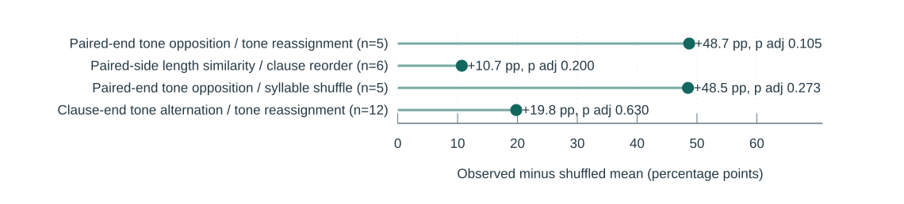

# Reading ease and sound-pattern beauty in Chinese parallel prose

## Question and result

What makes a Chinese passage easy to say on its first reading (顺口), and which properties of its audible pattern make it pleasing to hear (音律美)? This pilot starts with parallel prose (骈文) and period-matched comparison prose (散文). It asks how historical sound patterns, the phrasing of an edition, and the sounds heard in a particular performance relate to the two judgments.

**Pilot result.** Written clause length strongly tracked articulation time in the controlled Mandarin recordings. Historical level–oblique alternation (平仄) showed weak or mixed associations with performed pitch, and every formal comparison with a shuffled control exceeded the 0.05 threshold after correction. In the earlier author follow-up, shorter clauses coincided with easier first reads and higher overall listening ratings. In the independent-work expansion, the two listening pairs tied when clauses were weighted equally. The easier first read had longer clauses in one period and shorter clauses in the other. Independent readers and listeners are needed to test the associations. [Formal and acoustic validation](stage-5.md) · [Author follow-up](#author-rating-follow-up) · [Independent-work expansion](#independent-work-expansion)

## Prior work and the contribution

**Established source evidence.** 劉勰’s 《文心雕龍·聲律》 links combinations of shared onsets (雙聲) and rimes (疊韻) to difficulty in oral delivery. In 王銍’s 《默記》, 章惇 reportedly judged two short clauses in 歐陽修’s 《峴山亭記》 abrupt and preferred adding two characters to each. The revision changes wording, length, and the final sounds together. 《古文評註》 identifies a particular rhetorical break (文氣一頓) in the same text. 莫道才 attributes part of the cadence of 王勃’s 《滕王閣序》 to alternation within clauses and contrast across paired clauses. His appraisal applies to the whole work. These sources give specific variants, locations, and features to test. [《聲律》, chapter 33](https://zh.wikisource.org/wiki/文心雕龍/聲律) · [王銍, 《默記》卷下](https://www.shidianguji.com/zh/book/CZBZZ051/chapter/1kxs7vmwg6230) · [Received 《峴山亭記》 and notes](https://zh.wikisource.org/w/index.php?title=峴山亭記&oldid=870702#註釋) · [莫道才, 2025](https://news.gxnu.edu.cn/2025/0802/c1330a319711/page.psp)

**Established experimental results.** Duanmu and Stiennon found substantial flexibility in the tonal positions of seven-character regulated verse (近體詩). Their paper uses different matching rules for individual lines and full poems, so exact denominators and reading rules matter for replication. Li, Wang, and Yang found different electrophysiological response patterns after rhyme-vowel and tone violations in listened-to quatrains. Teng and colleagues observed line-scale grouping when Mandarin listeners heard quatrains made from syllables of equal duration. These experiments establish sensitivity to learned patterns in particular tasks. They leave the relationship between pattern detection and appreciation open. [Duanmu and Stiennon, 2005](https://websites.umich.edu/duanmu/PingZe05.pdf) · [Li, Wang, and Yang, 2014](https://journals.plos.org/plosone/article?id=10.1371/journal.pone.0085683) · [Teng et al., 2020](https://pmc.ncbi.nlm.nih.gov/articles/PMC7141976/)

**Transfer from English.** Breen’s read-aloud analyses show how to test what metrical position adds after accounting for lexical and syntactic predictors of duration. Scheepers and colleagues’ limericks show how to compare distinct edits and ask whether listeners detected them. Gollan and Goldrick’s prose experiment shows why reading time, production errors, and self-corrections warrant separate measures. These designs transfer to Chinese prose. The predictions must be specified for Chinese tone, clause structure, and the recorded manner of reading. [Breen, 2018](https://www.sciencedirect.com/science/article/abs/pii/S0010027718300222) · [Scheepers et al., 2013](https://journals.plos.org/plosone/article?id=10.1371/journal.pone.0074986) · [Gollan and Goldrick, 2019](https://pmc.ncbi.nlm.nih.gov/articles/PMC6367048/)

**Contested claims.** The scope of a fixed ordering of paired clause-final tones or a horseshoe pattern (馬蹄韻) across pairs remains unsettled. Pairing also enters scholarly definitions of 骈文, so using a parallelism threshold as the genre label would bias a known-groups test of that same feature. The corpus records passage genres from the source context and documents manually proposed pairings. [陳果, 2020](https://xbshkx.cdut.edu.cn/cn/article/pdf/preview/10.3969/j.issn.1672-0539.2020.02.013.pdf) · [莫道才, 2025](https://news.gxnu.edu.cn/2025/0802/c1330a319711/page.psp) · [Corpus design](../data/pilot/DATA_CARD.md)

**Project contribution and hypothesis.** The distinctive test is whether edition-specific features predict cold-reading difficulty and blind listening preference for parallel prose after accounting for clause length, vocabulary, syntax, and performance. A historical critic’s documented preference can select a comparison, while independent works and readers can test whether the relation generalizes. A clause-final tone contrast might help listeners hear the two halves of a pair even when unfamiliar diction makes the passage hard to say. The annotated pilot and the two instruments make that hypothesis testable. [Evidence synthesis and related tools](../research/synthesis.md) · [Full annotated bibliography](../research/literature.md)

## Framework and corpus

The unit of analysis is an ordered set of Han-character syllable positions within editorial clauses (句讀). A position carries the witness character, punctuation boundary, and available candidate readings. 《廣韻》 supplies the primary historical categories. 《平水韻》 supplies a sensitivity check. An independently annotated parallel pair (對仗 or 對偶) can span several clauses. Competing readings remain visible. Where alternatives agree on a field, that field can contribute even while the reading remains unresolved. Values for other relations report finite support and feasible bounds where the dictionary supplies candidates. Clause lengths, ending-tone contrast, onsets, finals, and historical rhyme-group recurrence (韻部) describe different aspects of the form. The verse template and weighted edit methods remain available as reference work. A prose composite would require feature weights estimated against independent outcomes. [Definitions and worked examples](../theory/foundations.md) · [Historical lexicons](../data/phonology/HISTORICAL.md)

The recorded performance supplies its own speech intervals, pitch, and decoded pronunciation evidence. The system estimates acoustics at the waveform first, then matches the events to the written slots. For example, normalized pairwise variability (nPVI) compares the absolute difference of successive lengths or durations with their local mean. Comparing the two versions on a common set of clauses helps identify where character count explains timing. Time occupied by speech and elapsed time including pauses represent different quantities. The procedure keeps historical tone class, prescribed synthesis, a waveform-derived pronunciation draft, and a reviewer-confirmed pronunciation in distinct fields. [Acoustic definitions](../audio/ACOUSTIC_FEATURES.md) · [Waveform and alignment method](../audio/README.md#pronunciation-and-alignment) · [Zhu, Zhang, and Jurgens, 2022](https://doi.org/10.1109/ICASSP43922.2022.9746112)

| Material | Coverage and use |
| --- | --- |
| Matched prose | Twelve 20–28-character excerpts in six period- and topic-matched pairs. Three pairs use sixth-century works and three Early Tang works. Within-pair lengths differ by at most four characters. |
| Critic probes | Three Northern Song excerpts, including the two historic variants and a received-text location marked for a rhetorical break. Fourteen other spans serve as formal references outside the matched sample. |
| Rights and editions | Nine pinned Wikisource revisions for the fifteen pilot excerpts. The classical works are public domain. The transcription and punctuation layer requires contributor attribution and CC BY-SA 4.0. |
| Synthetic recordings | Ninety experimental Kokoro Mandarin takes across the fifteen excerpts, two voice presets, and three speeds. Manifests retain text and recording hashes, intended phonemes, model and voice identifiers, synthesis condition, and rights. |
| Human recording | One U.S. public-domain LibriVox reading matches 《蘭亭集序》 at the work level. Verified reuse coverage at the exact fifteen pilot excerpts is zero. Performed variety and exact spans for the reference remain unresolved. |

[Text records and reuse](../data/pilot/DATA_CARD.md) · [Synthetic records](../audio/SYNTHETIC.md) · [Human recording provenance](../audio/HUMAN_SOURCES.md) · [Stage 3 coverage](stage-3.md) · [Stage 4 coverage](stage-4.md)

## Results

### Formal patterns under shuffled controls

**Pilot observation.** The tests used 999 seeded draws per control for within-clause syllable shuffling, intact-clause reordering, and tone reassignment within period and genre. They kept the observed passage support and work weights fixed within a test. The strongest 《廣韻》 effect was **+48.7 percentage points** for paired-end tone opposition relative to tone reassignment, with five represented passages and Holm-adjusted *p* = 0.105. Annotated paired-side length similarity was **+10.7 points** over reordering, with six passages and adjusted *p* = 0.200. All 21 《廣韻》 and 19 《平水韻》 adjusted tests exceeded 0.05. Several length descriptors stayed invariant under these controls, as expected from what the shuffles preserve. [Control definitions, effects, and denominators](stage-5.md#shuffled-controls-and-matched-genres)

*Figure 1. Selected contrasts from the primary historical tier. Effects are work-weighted differences in percentage points. The adjusted values account for the tests in that tier.*

The share of four- or six-character clauses (四六) was 15 percentage points higher on average in the parallel-prose samples than in their matched comparison passages. Two pairs favored 骈文, one favored comparison prose, and three tied. Accounting for excerpts shared across works left two independent connected blocks for the exact sign check. The minimum attainable two-sided *p* was 0.5. This comparison estimates a sample contrast. [Paired results](stage-5.md#shuffled-controls-and-matched-genres)

### What carries through to sound

**Pilot observation.** The waveform-first decoder linked 2,102 of 2,370 expected syllable positions (88.7%) for draft timing. Across passage medians, mean clause length and mean articulation time agreed strongly (Spearman ρ = 0.952, 11 passages). Their standard deviations agreed at ρ = 0.950 and their nPVI at ρ = 0.921. Clause-end historical tone alternation and changes in late fundamental frequency (F0) agreed only weakly (ρ = 0.190, 12 passages). The high association for historical level-tone share partly reflects the use of the same historical labels in the numerator on both sides. [Draft coverage](stage-4.md#acoustic-draft-results) · [Acoustic comparisons](stage-5.md#text-against-stage-4-sound)

*Figure 2. Correlations across passages, using only shared usable positions for each comparison. Each passage summarizes available voice and speed conditions. Eligible passage counts appear on the left.*

All 43 quiet-gap candidates of at least 150 ms in the matched set occurred at punctuation. There were 180 eligible punctuation positions and 1,090 eligible positions elsewhere. The synthesizer received punctuation, so this result describes the generator and measurement conditions. Some individual cases illustrate why the dimensions matter. ET01’s sole usable adjacent-clause contrast had zero variability in length and timing nPVI of 16.59. The two 《峴山亭記》 variants both showed historical ending-tone opposition, yet the median absolute terminal-pitch difference changed from 9.86 to 4.52 semitones alongside the changes in wording and length. [Agreement and largest disagreements](stage-5.md#text-against-stage-4-sound)

### Direct measurement readiness

**Controlled result.** Re-decoding twelve synthetic originals and their 120 ms pause edits recovered the affected gap within 20 ms in all twelve pairs, with 5 ms median absolute error. This checks a known change at low-amplitude splice positions previously located with the same model. In a separate proxy check across the twelve matched passages, draft discrepancy and conditional Charsiu phone confidence correlated at ρ = −0.48. Shared decoder dependencies limit what the agreement says about the reader. Isolated changes in final tone, rhyme, and clause length remain untested for listener preference. [Pause and proxy audits](stage-6.md#acoustic-checks-and-machine-proxies)

The stage prepared four anonymous listening pairs and a cold read-aloud task using four different passages from different works. A separate, earlier author trial used six excerpts and two 1–7 scales. Scores fell between 5 and 7, and the two judgments differed for three items. That earlier trial checked wording and scale usability. [Earlier author trial](stage-2.md#author-trial-response) · [Stage 6 instruments](stage-6.md#author-tasks)

### Author rating follow-up

In the first pilot, one author supplied four overall 音律美 ratings, one per listening pair, and four 顺口 self-ratings, one per read-aloud passage. Both scales ran from 1 to 7. The Gilbreth analysis checked the listening stimulus hashes, the exact text witnesses, and the source recording links before joining the data. The individual responses and joins stay in the private Gilbreth project. These comparisons are descriptive and were made after the ratings arrived. [Comparison code](../src/stage6_author_comparison.py) · [Rebuild instructions](../hpc/README.md#compare-author-ratings)

#### Overall 音律美 by listening pair

Each pair is one observation. The table averages the two clips' measures within each pair and then averages the two pairs at each rating level. The duration difference is the absolute gap between the two played clips. Historical measures use 《廣韻》. The pitch measure comes from the Stage 4 source takes at shared usable clause endings. In the pause comparison, both clips derive from the same source take. Its pitch entry represents that source speech.

| Measure | Lower-rated pairs (2) | Higher-rated pairs (2) |
| --- | ---: | ---: |
| Mean written slots per clause | 5.55 | 4.40 |
| Share of four- or six-slot clauses | 80% | 95% |
| Successive historical clause-end 平仄 alternation | 54% | 50% |
| Presented clip duration per written slot | 246 ms | 269 ms |
| Absolute difference in total duration between clips | 700 ms | 335 ms |
| Mean absolute late-F0 difference across source clause endings | 4.98 semitones | 5.99 semitones |

The higher-rated pairs had shorter written clauses, longer audio duration per written slot, and a smaller gap in total clip duration. Historical alternation was similar across the two groups, and exact historical rhyme-group recurrence at adjacent endings was zero across the four pairs. Each rating group contained one period-matched pair. The higher group also included the same-text pause pair, and the lower group included the compound historical wording revision. Including two versions of one text contributes to the small duration difference in the higher group. The pause audit recovered a 110 ms draft change for the known 120 ms insertion. The whole-pair rating leaves the preferred clip and the effect of that edit on preference unresolved. [Pause audit and pair design](stage-6.md#acoustic-checks-and-machine-proxies)

#### Overall 音律美 across the first two listening rounds

The same author rated the four pair designs again after they were rendered with a synthetic male Mandarin voice at nominal speed 0.9. The first round used nominal speed 1.0. The original Chinese wording was available alongside the audio during the second round. The comparison on Gilbreth matched exact text witnesses and edit specifications across the shuffled labels, including the same punctuation boundary and 120 ms insertion for the pause comparison. [Male Mandarin follow-up](stage-6.md#male-mandarin-listening-follow-up) · [Round comparison code](../src/stage6_round_comparison.py)

| Measure | First round | Male-voice round |
| --- | ---: | ---: |
| Mean and median overall rating | 5/7 | 5/7 |
| Rating range | 4–6 | 4–6 |
| Mean presented duration per written slot | 257 ms | 272 ms |

Two pair ratings rose, one fell, and one stayed the same. The mean absolute change was one point. The same-text pause pair held its score. This follow-up describes a combined change in voice, pace, and text availability. The author also heard the pairs again in a newly shuffled presentation. These conditions leave the contribution of the male voice itself and the preference between the two clips unresolved. The four scores in each round are whole-pair listening judgments.

#### Repeat ratings on the same male-voice survey

**Pilot observation.** The author gave a second overall 1–7 音律美 rating to each of the same four male-voice pairs. Gilbreth verified all eight WAVs, their A/B assignments and survey order, and the exact Chinese text for each clip. The earlier male-voice session made the Chinese lines available in a companion view. In the repeat, the author saw the Chinese lines separately in the Gilbreth terminal.

Every pair rose by exactly one point. Both the mean and median increased from 5/7 to 6/7, and the range shifted from 4–6 to 5–7. The four pairs retained their relative ratings. The fixed sequence and single author leave the effects of repeated listening, text placement, and other session differences unresolved. The individual ratings and matched comparison are stored privately on Gilbreth.

#### 顺口 by read-aloud passage

Across the four passages, easier self-ratings tracked shorter mean clauses (tie-aware Spearman ρ = −0.95) and a higher share of four- or six-slot clauses (ρ = 1.00). These related structural measures reflect much of the same contrast. In the Early Tang pair, the passage rated easier by three points averaged 4.67 written slots per clause versus 8.67 in its comparison, despite having 28 written slots overall versus 26. In the sixth-century pair, the author gave equal ease ratings to passages averaging 5.50 and 6.50 slots per clause. Total passage length and historical clause-ending alternation had weaker rank associations (ρ = +0.50 and +0.32). Historical rhyme-group recurrence was constant.

The audio comparison used the median across the six Stage 4 synthetic voice and speed settings for each exact passage. Higher ease ratings coincided with fewer draft alignment edits per 100 written slots (ρ = −0.63) and longer synthetic waveform duration per written slot (ρ = +0.63). In the Early Tang pair, the median draft-edit rate was lower for the easier passage (12.5 versus 26.9 per 100 slots). The sixth-century pair tied in ease despite different synthetic edit rates. Actual pace, pauses, and hesitations on the author's first readings remain unmeasured. [Synthetic proxies](stage-6.md#acoustic-checks-and-machine-proxies) · [First-read measures](../audio/STAGE6_PRODUCTION.md)

### Independent-work expansion

**Pilot observation.** The author rated two new pairs for sound-pattern beauty (音律美) and four different passages for first-read ease (顺口). Each pair contains parallel prose and period-matched comparison prose, and the two tasks use different works. During listening, the **original Chinese lines were visible below the clips**. The four clips used the same synthetic male Mandarin voice at nominal speed 0.9. Gilbreth verified the exact displayed text, served WAV hashes, prompt texts, and links to the Stage 4 feature tables. Individual ratings and matched records remain in private Gilbreth storage. [Test materials](stage-6.md#independent-work-pilot-expansion) · [Comparison code](../src/expansion_response.py)

#### 音律美 with visible Chinese text

Each rating covers a whole A/B pair. The main comparison gives the two clips in a pair equal weight. Pooled values give every clause equal weight. Historical measures use 《廣韻》. Source-waveform features use the draft alignment before playback level matching.

| Measure | Lower-rated pair | Higher-rated pair |
| --- | ---: | ---: |
| Mean written slots per clause, equal clip weights | 5.15 | 5.67 |
| Share of four- or six-slot clauses, equal clip weights | 70% | 50% |
| Mean written slots per clause, pooled | 5.11 | 5.11 |
| Share of four- or six-slot clauses, pooled | 66.7% | 66.7% |
| Historical level–oblique alternation at adjacent clause ends | 50% | 25% |
| Exact historical rhyme-group recurrence at adjacent clause ends | 0% | 0% |
| Playback duration per written slot | 270 ms | 273 ms |
| Difference in total playback duration between clips | 275 ms | 350 ms |
| Mean source articulation time for fully linked clauses | 942 ms | 1,245 ms |
| Mean absolute source pitch change across adjacent clause ends | 3.63 semitones | Unavailable |

Both pairs contain 46 written slots across nine clauses, including six four- or six-slot clauses. With equal weight per clip, the higher-rated pair had longer clauses and a smaller share of four- or six-slot clauses. The difference disappears when the clauses are pooled. Playback time per written slot was similar. The higher-rated pair had a larger gap in total clip duration. Historical alternation used four and six resolved transitions, respectively, out of seven per pair. The draft source alignment linked 39 of 46 slots in the lower-rated pair and 37 of 46 in the higher-rated pair. The articulation means cover four and three complete clauses, respectively. One clip in the higher-rated pair lacked usable adjacent endings for the pitch comparison and for comparing the decoder's modern final recurrence. The two ratings leave individual clip preferences and the contribution of seeing the text unresolved.

#### 顺口 after a first read

The easier passage had a greater share of four- or six-slot clauses in both period matches. Mean clause length moved in opposite directions. The sixth-century passages both have 25 written slots. The Early Tang passages have 29 and 28 slots, respectively.

| Matched period | Mean slots per clause, lower to higher ease | Share of four- or six-slot clauses, lower to higher ease |
| --- | ---: | ---: |
| Sixth century | 5.00 → 6.25 | 40% → 75% |
| Early Tang | 5.80 → 4.67 | 40% → 100% |

Historical clause-end alternation decreased in the sixth-century match and increased in the Early Tang match, with two to five resolved transitions per passage. Exact historical rhyme-group recurrence was zero in all four excerpts. The read-aloud task supplied self-ratings on the four passages. With no first-read recordings, actual pace, pauses, and hesitations remain unmeasured. [First-read protocol](../audio/STAGE6_PRODUCTION.md)

## Failures and threats to validity

- **Sampling and genre.** The sample is short, purposefully selected, and concentrated in a few repeated source works. Literary familiarity, syntax, allusion, topic, and modern editorial punctuation can influence the contrasts. The data support descriptive findings for the selected passages. Comparative conclusions on older and regulated verse, rhapsody (賦), lyric verse (詞), and song (曲) require their own annotated samples. Published 七言 benchmarks still require replication using the specified edition and alternate reading policy. [Data coverage](stage-3.md) · [Known-text checks](stage-5.md#known-text-fixtures)
- **Model and measurement.** Faster synthetic takes had lower alignment coverage. Some text–sound comparisons were unavailable because one side was constant or there were too few complete paired intervals. Decoder confusion and actual pronunciation differences can both produce draft discrepancies. Independently reviewed vowels, consonants, inhalations, and melodic anchors are needed for vowel proportion, consonantal timing spread, breath groups, and tone–melody alignment (依字行腔). [Audio limitations](stage-4.md#interpretation-and-remaining-coverage)
- **Interpretation.** A synthetic pause, corpus-level association, or historical appraisal supplies evidence of a particular kind. Whether a listener prefers the pause or a reader hesitates at that site remains a study question. Named critics and anthology selections preferentially preserve exceptional examples. One reader, one voice, or one delivered variety would leave performance and text effects entangled. [Criticism-led designs](../theory/foundations.md#7-criticism-led-tests-for-骈文)
- **Author follow-up.** All of these ratings come from one author. The first two listening rounds use the same four pair designs. The later male-voice repeat reuses the same recordings in the same order. The expansion has two new listening pairs and four other excerpts for read-aloud. Its listening condition combines visible Chinese text with a single synthetic delivery, and the read-aloud evidence consists of self-ratings. The comparisons are descriptive.

## Model development before human validation

The next phase uses existing texts and synthetic recordings to establish which features are reliable. On four works held out of calibration, written character count predicted synthetic clip duration with a mean absolute error of 207 ms. Adding the number of clause breaks raised error to 406 ms. This is a timing benchmark for one synthetic delivery. It supports the use of character count as the timing baseline and leaves the human outcomes open. [Held-out benchmark](stage-5.md#work-held-out-synthetic-timing-benchmark)

The fresh-work benchmark tested 16 additional prose works. The character-count baseline averaged 758 ms absolute duration error. Adding the 《廣韻》 level-tone share raised error to 781 ms, and adding rhyme-group concentration raised it to 819 ms. The small improvements under 《平水韻》 fell within the shuffled-control range. At usable clause endings, historical alternation had a descriptive association of ρ = 0.333 with draft pitch change. Exact historical rhyme recurrence was too sparse for the corresponding comparison. [Fresh-work benchmark and controls](stage-5.md#historical-tone-and-rhyme-on-fresh-works)

At eight internal clause endings, fixed-text Mandarin tone and final edits were measured separately. The tone resynthesis produced the intended pitch direction in two of five measurable cases. The three measurable rhyme cases recovered the intended modern final match or mismatch. A direct waveform control verified a falling-versus-flat pitch contrast at two sites while preserving all samples outside each edit. [Minimal pairs and waveform limits](stage-5.md#fixed-text-tone-and-rhyme-minimal-pairs)

The direct pitch extension verified 15 more sites, including seven previously untested works. The falling version dropped 3.51 semitones more than the flat version at the median site. Each pair kept the same characters and duration, with identical audio outside the edit. The new sites were selected for clear voicing in the source recordings. Rhyme alignment recovered two previously unlinked endings, raising coverage from 22 to 24 of 32. Re-decoding the remaining endings with different amounts of surrounding audio did not meet the agreement criterion at any additional site. Three of eight rhyme pairs were fully measurable. All three moved in the intended spectral direction in the central portion of the final, and two did so near the end. These checks verify acoustic differences in synthetic speech. The effects on listening judgments of 音律美 and first-read ease (顺口) remain separate questions for final validation. [Expanded waveform controls](stage-5.md#expanded-pitch-controls-and-rhyme-alignment)

Gilbreth tested the recitation guide's 2+2 and 1+1+2 phrasing on the same four-character text in 12 clauses, including 人間何世. Each pair used a common synthetic recording with the same 80 ms total pause added. The waveform check recovered one 80 ms gap after the second character for 2+2 and two 40 ms gaps after the first and second characters for 1+1+2. Its timing contrast exceeded the 95th percentile of the work-block shuffle control. The phone decoder could measure both gaps for five of the 12 pairs and recovered the intended directions in all five. Later 音律美 judgments can test whether listeners prefer either version. 顺口 remains a separate first-read outcome. [Phrasing experiment](stage-5.md#fixed-text-recitation-phrasing)

The alignment extension added 日暮途遠 as a thirteenth pair and retained the original 12 pairs byte for byte. Neighboring syllables supported one timing interval for 途, with conflicting phone evidence preserved. The two versions had the same text and lasted 6.705 s each. Matching identical speech samples recovered the pause placement in all 13 pairs. The transferred timing intervals specify uncertainty where the original draft boundaries are close to an insertion. A phone re-decode with different surrounding audio found no additional gaps that met the agreement criteria. [Recitation alignment extension](stage-5.md#alignment-extension-and-日暮途遠)

The second aligner, FunASR, returned timings for all 39 unchanged recordings, including the common carriers. It recovered both pause-change directions in 9 of 13 pairs from the spacing of character midpoints and in 2 of 13 from gaps between its character spans. In 日暮途遠, the estimated midpoint for 途 shifted 80 ms in both versions, agreeing with the waveform. Its estimated span began 3.5 ms after the matched waveform core ended. For these pause edits, waveform matching establishes the exact placement, and FunASR supplies an independent check on relative timing. The edited recordings provide timing controls for later 音律美 listening. 顺口 remains a separate first-read outcome. [Second Mandarin aligner](stage-5.md#second-mandarin-aligner)

An estimator that reads only the target WAV measured low-energy gaps between adjacent FunASR character midpoints. The mean error against exact waveform timing fell from 14.03 ms with midpoint spacing to 10.56 ms with the fixed waveform threshold. Selecting the threshold on other works reduced error to 9.38 ms and recovered both edited directions in 10 of 13 pairs. Every fold chose −50 dBFS. The first edited pause still tended to be underestimated. This is evidence about timing in the same synthetic voice. It gives a candidate feature to check on an independent delivery before listening or read-aloud validation. [Single-recording pause benchmark](stage-5.md#measuring-pauses-from-a-single-recording)

The same 13 clauses were rendered with a second Kokoro voice using the same text, pronunciation prescription, speed setting and seed for each source. Within each voice, treatment duration remained fixed and exact waveform matching recovered the intended change in all 13 pairs. At the frozen −50 dBFS threshold, direction agreement fell from 10 of 13 pairs in the original voice to 6 of 13 in the second, and mean error rose from 9.38 to 14.03 ms. The second-boundary change remained accurate at the median. The first-boundary change was underestimated and its direction was missed for 日暮途遠 in both voices. The feature measures a real timing contrast with delivery-dependent precision. Its usefulness for 音律美 listening judgments and the separate 顺口 read-aloud outcome remains to be validated. [Second-voice benchmark](stage-5.md#transfer-to-a-second-synthetic-voice)

The quantitative report tested four new period- and topic-matched pairs from eight independent works, each recorded in both synthetic voices. It reports clause structure, historical ending measures with reading coverage, and exact clip durations. Only 10 of 42 clauses had complete articulation timing in both voices. An exploratory check using matched first and last characters expanded shared elapsed-time coverage to 22 clauses across all eight works. On that subset, character count predicted elapsed time on held-out works with 56 and 58 ms mean absolute error for the two voices. The constant baselines had 274 and 276 ms error. Shuffled within-work lengths had median errors of 166 and 160 ms. The result supports conditional timing diagnostics with explicit coverage. 音律美 listening and 顺口 first-read evidence remain separate outcomes for final validation. [Quantitative report checkpoint](stage-7.md#quantitative-diagnostics-on-fresh-works)

The second aligner returned raw timestamps for all 42 clauses in each voice on the same Gilbreth recordings. Applying the prespecified 60 ms midpoint agreement rule and local two-sided checks for missing endpoints added one shared elapsed span, 必浚其泉源, raising coverage from 22 to 23 of 42. Complete articulation was still available for 10 of 42 clauses in both voices. FunASR midpoint estimates were a median 80 ms later than Charsiu in each voice. The single shared FunASR-supported clause was too sparse for a new held-out model check. For 音律美, this adds one timing diagnostic. 顺口 requires a separate first-read test. Participant testing is reserved for final validation. [Second-aligner methods and results](stage-7.md#second-aligner-coverage-across-both-voices)

Direct measurement of waveform activity showed that moving every FunASR timestamp 80 ms earlier increased clip-onset error in both voices. An exploratory onset-only shift fitted on other works moved the estimated onsets 29–35 ms earlier and reduced held-out error from 37.5 to 26.7 ms and from 32.1 to 17.5 ms. Four clip offsets and all four eligible internal pause edges came from one voice, so there is insufficient evidence for a shared correction to clause endpoints. The v4 rerun retains the original 23 shared elapsed spans. This is a timing result for 音律美 research. Evidence for 顺口 awaits separate first-read validation. [Waveform audit and held-out results](stage-7.md#waveform-check-of-the-80-ms-offset)

The onset adjustment was then frozen at 35 ms earlier and tested on 16 different works. On the nine works with usable waveform starts in all three voices, error fell from 45.0 to 24.4 ms, from 30.0 to 20.6 ms, and from 45.0 to 20.0 ms. The third voice was entirely held out of the fit. Applying the same correction inside controlled audio joins roughly doubled errors in the two tested voices. Regenerating the native recordings exactly and checking the synthesizer's punctuation timing left all 13 stable native quiet intervals unlabeled under the agreement rule. The demonstrated correction applies to isolated recording onsets. [Independent transfer and internal controls](stage-7.md#independent-onset-transfer-and-internal-boundary-controls)

The original WAVs reproduced all 13 quiet intervals. Matching the resumption of speech to adjacent Han positions gave 11 candidate clause breaks, seven corroborated by a Charsiu phone draft in `zf_001`. In held-out controlled joins, automatic detection yielded one correct assignment in 16 trials in `zm_010` and nine in 16 in `zf_001`. When given the sample-defined guard and an independently measured speech resumption, the matcher found the correct position in both voices on all ten jointly eligible works. The voice-dependent detector is the bottleneck. Two native held-out candidate positions appeared in both voices, with accuracy still awaiting independent boundary labels. [Original and held-out pause results](stage-7.md#assigning-native-pauses-and-testing-held-out-clause-boundaries)

Setting thresholds relative to each recording raised correct assignments from 12 to 32 of 36 clean joins across three voices on the expansion works, and from 12 to 36 of 36 on four newly sourced works. The same fixed matcher handled both detectors. Under the milder artificial noise level, the relative detector still found all 36 quiet intervals, with usable timing at 11. The fixed detector retained 21 usable edges. At the higher noise level both missed every insertion. The independent transcription audit located only one of 32 known joins with the larger Whisper checkpoint and gave little extra support for native clause labels. These results support the new detector for clean synthetic timing diagnostics and leave native clause identity provisional. [Detector and transcript results](stage-7.md#relative-energy-pause-detection-and-independent-transcripts)

Estimating the background floor recovered speech-resumption timing within 20 ms for all 36 exact interior insertions at each of two noise levels on four held-out works across three voices. It produced zero false matches at the unchanged and short-pause control sites. With background noise added to controlled joins, the unchanged matcher also found all 36 known breaks at each level. All 33 joins with an independent clean onset reference were within 20 ms. These measurements support the 音律美 timing pipeline under controlled stationary noise. 顺口 still requires independent first-read evidence. [Noise-aware validation](stage-7.md#noise-aware-pause-timing-across-three-voices)

On five natural smartphone readings of the same Mandarin prose passage, the frozen detector found 12 of 29 pauses marked in a blind waveform review. All 12 proposals matched a reference pause, and only three of the 29 pauses had usable speech-resumption timing within 20 ms. Across the full readings, it overlapped 16 of 51 long gaps at independently marked clause endings, using the corpus’s forced alignment to locate those endings in audio. The natural-speech results support using detected pauses as review candidates for 音律美 timing. Listening judgments for 音律美 and first-read outcomes for 顺口 each require final participant validation. [Natural Mandarin benchmark](stage-7.md#noise-aware-pause-detection-in-natural-mandarin-readings)

A replay of the 17 ManDi misses found that ten quiet runs covered too little of the marked pause, often after brief interruptions split the run. An experimental bridge across weak interruptions of up to 20 ms found 21 of 35 pauses in seven fresh recordings, up from 16, and doubled the number of usable resumptions within 20 ms from six to 12. In the two 骈文 excerpts, recovery rose from 10 of 16 to 14 of 16. On one modern prompt read by three distinct speakers, recovery was six of ten in both runs. The independent references are detector-blind visual estimates. These results support acoustic timing diagnostics for 音律美. 顺口 still calls for separate first-read evidence at final participant validation. [Miss audit and held-out results](stage-7.md#miss-audit-and-weak-interruption-bridge-on-held-out-readings)

Pre-boundary syllable duration showed consistent added value for detecting where readers group words. In a model fitted on separate texts and readers, the combined model preferred the intended boundary in 92.0% of 50 matched pairs across four held-out modern Mandarin readers with no detected pause in either take. For ten fresh classical works, a Qwen timing fallback raised coverage from 85 to 192 of 193 independently marked sites while retaining the original Charsiu estimates at all 85 previously usable sites. In the fallback pipeline, adding duration raised average precision from .680 to .889 and improved the probability estimates. Training used entirely separate works and excluded the test recording’s published voice group. Individual classical reader identities are unknown. The fallback’s 80 ms estimates support coarse timing. 音律美 still requires listening judgments, and 顺口 still requires distinct first-read evidence. [Gilbreth experiment and limits](stage-7.md#pre-boundary-syllable-duration-on-held-out-readings)

The written holdout 《唐董韶容墓誌銘（並序）》 contains classical prose, parallel prose, and rhymed verse. On Gilbreth, a fixed written-cadence prototype trained on 209 earlier editorial labels for 《拉法叶赋》 used only 4–6 across the 20 complete units. A separate editorial pass used 4–7. The prototype rated verse lower, and its same-line features omit rhyme connections across lines. Two units with illegible characters were left unscored. This establishes score compression on this work. Coverage of the 1–7 listening scale remains an empirical question. [Held-out results and transcription](stage-7.md#mixed-genre-external-holdout-candidate)

The separately fitted historical duration models found a small predictive gain for 廣韻 rhyme concentration, the proportion of resolved written position pairs sharing a rhyme group. Adding it to character count reduced whole-clip duration error by 14–17 ms across three voices on the same eight held-out works. One voice met the adjusted shuffle threshold. Adding level-tone share increased error, and the rhyme benefit disappeared under 平水韻. The candidate remains a reference-dependent timing feature for 音律美 research. 顺口 requires independent first-read evidence, and new participant testing remains at the final validation stage. [Historical descriptor transfer](stage-7.md#transfer-of-historical-descriptors-for-synthetic-clip-duration)

The average share of four- and six-character clauses was about 30 percentage points higher in the selected 骈文 excerpts across both matched cohorts. The difference exceeded the randomized cut control that held passage length and clause count fixed. Three of the four v4 pairs favored the parallel excerpt and one tied, giving a coarse genre-swap test. Removing the marked project-added punctuation retained those directions. The result supports 四六句 share as a structural descriptor. [Written clause comparison](stage-7.md#written-four--and-six-character-clauses)

Sample more independent sixth-century and Early Tang works and group editions and variants by work. Reserve untouched works for evaluation. Check historical features against length and structure baselines, shuffled text controls, and both historical dictionary tiers. Use single-feature waveform controls and report coverage and sensitivity across deliveries. Freeze the supported features and keep the 音律美 and 顺口 analyses separate before collecting human judgments. [Model-readiness checks](../research/followup-pilot.md#model-readiness)

### Does context or audio help score a new work?

The prototype lets us hold the scoring rule fixed and test what each feature contributes. We compared its predictions with GPT’s written 音律美 judgments on 34 units from two complete Tang works. Adding cross-line rhyme and structural parallelism reduced average error from 0.88 to 0.83 points. It helped on 劉禹錫’s 《佛衣銘（並序）》 and hurt slightly on 白居易’s 《荔枝圖序》. Most shuffled line orders did at least as well as the original. Simply assigning the training median of 6 to every unit gave a smaller average error of 0.53. The prototype still gives 4 to all three of Bai’s 「葉如桂，冬青」「華如橘，春榮」「實如丹，夏熟」 units, each rated 6 in the written reading. Their repeated frame is easier to hear when the three are read together. That interpretation remains a hypothesis for listening. [Checkpoint and source editions](stage-7.md#cross-line-rhyme-and-parallelism-on-two-new-tang-works)

Gilbreth produced 68 synthetic Mandarin readings in two voices. Nineteen of the 34 units had a usable internal boundary in both voices. Across held-out works and voices, average error against the written score rose from 0.88 with text alone after recalibration to 0.92 with measured pauses and pre-boundary syllable duration. Two comparisons improved and two worsened. The audio features remain useful for studying phrasing. Their contribution to *heard* 音律美 awaits listening judgments. Reading ease (顺口) still has its own first-read test, reserved for final participant validation. Line-level comparison on Gilbreth (`$SHUNKOU_ROOT/results/editorial-context-20261122/line-scores.txt`)

### Can repeated grammatical patterns beat always predicting 6?

They helped the prototype identify patterned prose. They barely changed its written 音律美 scores. On 74 units from four complete Northern Song works, mean error fell from 0.989 to 0.987 points when we added the grammatical features. Simply assigning every unit 6 gave an error of 0.704, weighting each work equally. Always-6 won on each work separately. Shuffling character positions usually removed the small contribution from grammar, while 186 of 199 shuffled line orders gave the combined model an equal or lower error than the original order. [Four-work benchmark and controls](stage-7.md#repeated-grammatical-patterns-on-four-fresh-northern-song-works)

The rule recognized all three linked units in the earlier 「葉如桂，冬青」 example. Its score remained 4 for each, against GPT’s written score of 6. In the 209-unit training work, just eight units showed a partial match and none showed a repeated whole-line frame. On the four fresh works, a separate GPT reading identified nine clear parallels between adjacent units, of which the detector found five. Its matches included 「夏宜急雨」「冬宜密雪」 in 《黃岡竹樓記》. The historical commentary in 《古文觀止》 also draws attention to the six consecutive 宜 expressions in this passage. That gives us a way to explain the writing. Learning how much such a construction contributes to a 1–7 score will require a broader set of scored works. First-read ease (顺口) and participant testing remain separate. [Historical commentary](https://zh.wikisource.org/wiki/Special:PermanentLink/2520741#黃岡竹樓記) · All 74 line scores on Gilbreth (`$SHUNKOU_ROOT/results/grammatical-patterns-20261122/line-scores.txt`)

### What changed after training on six more works?

The written scoring model learned from 337 units across seven works, up from 209 in 《拉法叶赋》 alone. The new training passages include 22 units in five works that repeat a whole-line grammatical pattern. Eighteen units belong to three-line runs. The earlier training set had none. One interjection, 「嗟乎！」, was kept out of training because it also occurs in an earlier test. [Sources and coverage](stage-7.md#expanding-the-grammatical-pattern-training-set)

On two new Tang works, the average distance from a GPT reader’s 1–7 written 音律美 judgments fell from **0.81 to 0.76 points**, giving each work equal weight. The model improved on 元結’s 《右溪記》 and did slightly worse on 王維’s letter to 裴迪. Always giving 6 still did better overall, at **0.69**. Removing the grammatical-pattern features from the expanded model gave essentially the same result (**0.76**). The two fresh works contained only two partial matches under the rule and no whole-line matches. The benefit of additional training on repeated constructions still needs a fresh test that contains them. First-read ease (顺口) and listening remain separate outcomes. Original lines, judgments and predictions on Gilbreth (`$SHUNKOU_ROOT/results/grammatical-training-expansion-20261122/results/reading-comparison.txt`)

For a check on passages that *do* repeat a pattern, we withheld each of the six historical additions in turn. On 22 matching units across five works, adding the grammar rules lowered average error from 0.78 to 0.74. Always giving 6 was still closer, at 0.57. These works were deliberately chosen to include parallel constructions, and the 22 matching units averaged 5.96 in the editorial reading when works were weighted equally. The result supports using grammar to point to a construction and suggests a small scoring benefit on similarly selected passages. [Six-work comparison](stage-7.md#expanding-the-grammatical-pattern-training-set)

### Did grammar help on fresh 骈文 that genuinely repeats a construction?

On seven confirmed units in two fresh parallel-prose essays, average error was **0.41 without grammar, 0.43 with grammar and 0.13 when always giving 6**. Including four units from 成公綏’s parallel fu gave the same ordering (0.37, 0.38 and 0.17). Nine of those eleven units received a written editorial rating of 6. In 29 units of period-matched ordinary prose, the two text models had virtually identical error (both 0.80), ahead of always-6 (0.87). Each work received equal weight.

The contrast is visible in the Chinese. Adding grammar helped 劉勰’s 「治戎燮伐，則聲有洊雷之威」, raising a low forecast from 5.62 to 5.92 against a written score of 7. In 劉峻’s 「聞……謂……」「視……謂……」「見……謂……」 sequence the reader gave each unit 6. The context model was already close, and the grammar features pushed all three too high. The model can point out these correspondences across lines. This six-work test gives no reason to treat repetition alone as a reliable bonus in the written score. Listening and first-read ease (顺口) remain separate final-stage outcomes. [Source editions, work-level results and controls](stage-7.md#fresh-parallel-prose-with-verified-three-line-constructions) · All 79 lines on Gilbreth (`$SHUNKOU_ROOT/results/fresh-three-line-transfer-20261122/results/reading-comparison.txt`)

### Does an ending change distinguish a 7 from a 6?

We tested 26 endings in ten works of parallel prose or prose containing parallel passages. The first six works supplied only two changes of written rhythm and no changes under the wording rule. Before looking at ratings, we added four works that contained a verified change in wording. One GPT reader rated the original full units with the model output and annotated endings hidden. Seven endings received a 7 and twelve received a 6.

**Adding a fixed bonus for a change in wording or written rhythm reversed none of the nine same-work 7-versus-6 comparisons.** The unchanged model, the adjusted model and always giving 6 each scored 0.50 on the primary ranking measure, where ties receive half credit and each eligible work counts equally. All three missed every 7 at the preset 6.5 threshold. Across all 26 endings, absolute error improved slightly from 0.803 to 0.785 with the adjustment, while always giving 6 was closer at 0.632.

The reader gave 陳琳’s turn from 「有非常之事」 to 「然後立非常之功」 a 7. Its prediction rose from 5.78 to 6.03. Changing an inventory’s final classifier from 副 to 通 also triggered the rule. That unit received a 4 and its forecast rose from 5.55 to 6.05. The visible departure can mark a consequential turn in the argument or simply a new item in a list. Our two signals do not reliably tell those functions apart. The current scorer therefore retains its existing weights. First-read ease (顺口) and listening remain separate final-stage outcomes. [Detailed design and results](stage-7.md#does-a-change-at-the-end-of-a-pattern-distinguish-a-written-7-from-a-6) · The 26 original endings on Gilbreth (`$SHUNKOU_ROOT/results/pattern-ending-transfer-20261122/results/reading-comparison.txt`)

### Does completing an argument deserve a higher written score?

**The fixed argument bonus made the 7-versus-6 ranking worse.** On Gilbreth we tested 54 endings from seven fresh works of parallel prose (骈文). Two AI annotators agreed on 31 argument conclusions and 13 list closures. A third AI reader independently scored complete original units without seeing the marked endings. Six works supplied a total of 22 comparisons where an argument and a list ended passages scored 7 and 6. With each work weighted equally and ties given half credit, the current model scored **0.750**, always giving 6 scored **0.500**, and adding 0.25 for an argument and subtracting 0.25 for a list scored **0.458**. The adjustment corrected four orderings and spoiled eleven. In 881 of 999 within-work shuffles, shuffled roles did at least as well as the observed change.

任昉’s list ends 「室邇人曠，物踈道親」. The pair of four-character clauses brings distance and closeness into balance. The reader gave this passage 7 and the preceding conclusion 「故以暉映先達，領袖後進」 a 6. In 陸機 the emphatic conclusion 「豈不謬哉！」 earned a 7. What the ending does can inform a close reading, but neither function deserves an automatic bonus in this pilot. [任昉](https://zh.wikisource.org/w/index.php?oldid=47732) · [陸機](https://zh.wikisource.org/w/index.php?oldid=48699)

The current model could often rank two passages in the reader’s order, yet it missed all fourteen 7s at the 6.5 reporting threshold. Across all 54 endings, always giving 6 had the smallest work-balanced absolute error (0.585, against 0.655 for current and 0.682 with function). These are written 音律美 judgments from one AI reader. First-read ease (顺口) and listeners’ ratings remain separate final-stage outcomes. [Detailed results and limitations](stage-7.md#argument-conclusions-and-list-endings) · Original endings beside the scores on Gilbreth (`$SHUNKOU_ROOT/results/ending-function-transfer-20261122/results/reading-comparison.txt`)

### Can recalibration catch 7s without promoting too many 6s?

**It caught five additional 7s and exceeded the pilot’s false-alarm limit.** On 390 earlier units from 17 works, we lowered the cutoff for a 7 from 6.5 to 5.9901. The pilot required higher recall and at most 20% of reference 6s promoted to 7, checked both across passages and with authors weighted equally. We sealed the cutoff before comparing predictions with a separately prompted AI reader’s judgments on 95 fresh units from six new authors.

| Rule | Fresh 7s caught | Fresh 6s promoted | Lower ratings called 7 |
|---|---:|---:|---:|
| Always give 6 | 0/13 | 0/43 | 0/39 |
| Current model | 0/13 | 0/43 | 0/39 |
| Recalibrated model | **5/13** | **12/43** | **15/39** |

The false-alarm rate among 6s was 27.9% pooled and 28.4% with authors equally weighted. It exceeded the limit even when any single fresh work was removed. Only five of the model’s 32 top-score calls agreed with the reader. Earlier leave-one-work-out validation had kept the equal-work false-six rate just under 20%.

Eleven fresh passages received an identical model forecast, 6.101362964972654. The reader’s ratings for them ranged from 4 to 7. In 何遜, 「鏡想分鸞，琴悲《別鶴》」 earned 6 and 「思等流波，終朝不息」 earned 7. Moving a single cutoff necessarily moves both together. The new threshold remains experimental. These results cover written 音律美. Heard 音律美 and first-read ease (顺口) remain separate final-stage participant outcomes. [何遜’s letter](https://zh.wikisource.org/w/index.php?oldid=2228875) · [Detailed results and work-level controls](stage-7.md#calibrating-the-decision-to-report-a-written-7) · All 95 original units and forecasts on Gilbreth (`$SHUNKOU_ROOT/results/top-score-calibration-20261122/results/reading-comparison.txt`)

### Why did eleven passages tie, and does developing the previous thought help?

The eleven passages all scored 6.101362964972654 because **all 16 raw model inputs were identical**. All had two four-character groups, the same balance and measured historical tone/rhyme patterns, and the same values for neighboring form and grammatical echoes. Every input was present. The model had already lost the distinctions before any arithmetic or rounding. It did not encode how one line develops what the last one said. Gilbreth feature-by-feature audit (`$SHUNKOU_ROOT/results/adjacent-thought-transfer-20261122/tie-audit.json`)

On six fresh works, two AI readers classified line-to-line relations and a third independently rated written 音律美. Across 65 genuine transitions, the readers agreed that 42 moved the preceding thought forward and 17 did something else. We tested a fixed 0.25-point bonus for an agreed advance. In the main same-work comparison, where one unit advanced the thought and the other did not, the bonus **corrected one of sixteen orderings**. With equal weight per work, ranking improved from 0.367 to 0.433. Always giving 6 scored 0.500 because every pair tied. Across all 55 same-work 7/6 comparisons regardless of role, the ranking rose from 0.534 to 0.567. All three methods missed all ten 7s at the 6.5 cutoff. There were no fresh exact-score 7/6 ties within a work to test directly.

The one correction was in 常袞: 「臣尚以愚劣偷安廟堂」 leads into the request 「伏乞解臣所職，更擇良才」. The reader gave the request a 7. In 羊祜 a coordinate answer, 「則使才臣不進」 followed by 「則使勞臣不勸」, also earned a 7. Either relationship can make a passage land. We retain the annotations and the existing model weights. Read-aloud ease (顺口) and listener judgments remain independent final-stage outcomes. [常袞](https://zh.wikisource.org/w/index.php?oldid=8735561) · [羊祜](https://zh.wikisource.org/w/index.php?oldid=47670) · [Full checkpoint and controls](stage-7.md#does-developing-the-preceding-thought-help-distinguish-a-7-from-a-6) · Original lines beside the scores (`$SHUNKOU_ROOT/results/adjacent-thought-transfer-20261122/results/reading-comparison.txt`)

### Can the model break a deliberately targeted exact tie?

**The carry-forward rule left the only same-work 7/6 tie unresolved.** Gilbreth screened 651 original units from 22 new works of parallel prose. Of 599 eligible targets, 62 belonged to 21 groups with identical full-precision model scores within a work. We froze all 62 before an independent AI reader rated their written 音律美. Of five editorial 7s, one had a 6 in its tied group and the other four had only 5s as partners. The current model, always giving 6, and the fixed bonus for an agreed development of the preceding thought all earned 0.50 on the single qualifying pair, the score for leaving it tied.

The pair comes from 伏知道. The 7-rated 「單枕一宵，便如蕩子」 answers 「九重千日，詎憶倡家」. The editorial reader cited the number contrast and the turn from 詎憶 to 便如. Both relation readers saw a coordinate contrast. The 6-rated 「輕扇初開，欣看笑靨」 follows 「人慚蕭史，相偶成仙」. Only one relation reader saw the smile as a development of that earlier union. Under the frozen rule neither passage received a bonus, and both stayed at 6.001927528386828. [伏知道’s letter](https://zh.wikisource.org/w/index.php?oldid=2458742)

Across *different* authors among the same selected passages, the feature resolved one of three additional 7/6 ties correctly and left two tied. With one informative within-work comparison, the study offers no reliable estimate of general tie-breaking performance. The model retains its current weights. Listening and read-aloud ease (顺口) remain separate final-stage outcomes. [Exact-score checkpoint](stage-7.md#can-thought-development-break-exact-76-ties) · All 62 passages beside their predecessors and judgments (`$SHUNKOU_ROOT/results/exact-tie-targets-20261122/results/reading-comparison.txt`)

## Final human validation

The prepared forms remain on Gilbreth for this final stage. The listening comparison holds WAVs fixed while varying Chinese text visibility and balancing pair and clip order. The separate first-read task records ease, familiarity, and pronunciation variety, with consented first takes available for checking pauses, hesitations, and repairs. Use fresh works and independently assigned readers and listeners once computational development is complete. [Human validation protocol](../research/followup-pilot.md) · [First-read measures and consent](../audio/STAGE6_PRODUCTION.md)

## Toolkit and reproducibility

`shunkou score` locates descriptive signals by paragraph and clause. The waveform path adds draft timings and review candidates tied to the exact text and recording. The software’s annotations can guide close reading and listening. They require human validation before use as scores of fluency or beauty. The Stage 7 checkpoint records the end-to-end verification and the runbook gives the source, data, and environment commands. The two release figures rebuild from the verified Stage 5 tables with `python3 -B reports/build_figures.py` and Gnuplot 5.4.3. The same script accepts the full Stage 5 validation JSON for a direct rerun. Working corpus, audio, model artifacts, and GPU results reside in the Gilbreth project. [Stage 7 checkpoint](stage-7.md) · [Gilbreth runbook](../hpc/README.md)

**UNVERIFIED.** The full Bradley and Terry 1952 article was inaccessible. The planned binary-choice analysis uses a conditional two-choice likelihood within each pair. The original full texts and performance archives that remain to be checked, including several regional recitation leads, are listed in the bibliography’s verification queue. [Stage 6 note](stage-6.md) · [Verification queue](../research/literature.md#to-verify)
